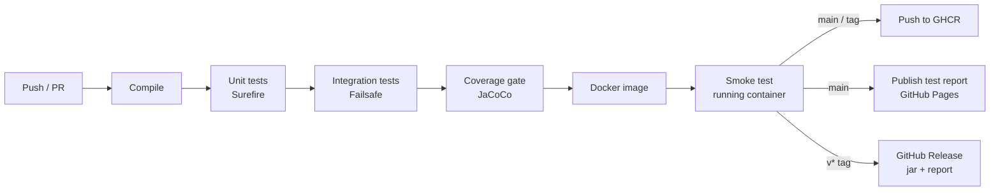

# ParcelPilot

[](https://github.com/kammatimanojsai-cmd/parcelpilot/actions/workflows/delivery.yml)

**Test report:** https://kammatimanojsai-cmd.github.io/parcelpilot/ (published by the pipeline on every push to `main`)  
**Container image:** `ghcr.io/kammatimanojsai-cmd/parcelpilot:latest`

ParcelPilot is a parcel delivery **quote and tracking API** for India, built with Java 21 and Spring Boot. It's a showcase for:

- **Data-driven JUnit 5 testing.** Test cases live in CSV and JSON tables. Adding a scenario means adding a row, not writing Java.
- **A complete delivery pipeline in GitHub Actions:** build, unit tests, integration tests, a coverage gate, a container image, a smoke test against the running container, a published test report, and a release on tag.

## What the API does

| Endpoint | Purpose |
|---|---|
| `POST /api/quotes` | Prices a parcel. Returns the zone, actual, volumetric and billed weight, an itemised bill and a delivery estimate. |
| `POST /api/shipments` | Books a parcel and issues a tracking number such as `PP1234567897`. |
| `GET /api/shipments/{id}` | Tracks a shipment: status, timeline and allowed next steps. |
| `POST /api/shipments/{id}/events` | Records a scan (pickup, in transit, out for delivery, delivered, failed attempt, return). |
| `GET /actuator/health`, `/actuator/info` | Health probe and build info used by the smoke test. |

`/` serves a small demo page for quoting, booking and tracking in the browser.

### Business rules (the things the tests pin down)

- **Zones from PIN codes:** same first 3 digits → `LOCAL`; a remote prefix (J&K/Ladakh `18`/`19`, North East `79`, Andaman `744`) → `REMOTE`; same first 2 → `STATE`; same first digit → `REGIONAL`; otherwise `NATIONAL`.
- **Billed weight** = the higher of actual and volumetric weight (L×W×H ÷ 5000 kg), rounded up to the next 500 g slab.
- **Price** = rate card (first slab + each additional slab) × service multiplier (Express 1.6×, Same day 2.5×), plus:
  - 12% fuel surcharge;
  - a COD fee of max(₹40, 2%) when cash on delivery applies (capped at ₹50,000);
  - 0.5% insurance when the declared value is above ₹5,000;
  - 18% GST on the total.

  Money is integer paise throughout, rounded half up at each step.
- **Delivery estimate:** bookings made by 14:00 on a working day are picked up the same day. Sundays and 26 Jan, 15 Aug, 2 Oct and 25 Dec are skipped, and movable festivals can be configured. Same-day service only runs within a city and must be booked by 11:00.
- **Tracking numbers** carry a Luhn check digit, so any single mistyped digit is rejected before a lookup.
- **Lifecycle:** `BOOKED → PICKED_UP → IN_TRANSIT → OUT_FOR_DELIVERY → DELIVERED`, with cancellation only before pickup. After 3 failed delivery attempts the parcel must be returned to origin.
- **Errors** are RFC 9457 problem documents with a stable `code`, such as `SAME_DAY_UNAVAILABLE` or `ILLEGAL_TRANSITION`. Status codes: 400 for bad input, 422 for a broken business rule, 409 for an illegal transition, 404 for an unknown shipment.

## Data-driven tests

**Latest run: 400 test cases, 0 failures, 99.4% line and 97.8% branch coverage** (see the [test report](https://kammatimanojsai-cmd.github.io/parcelpilot/)).

| Test data | Drives | JUnit 5 feature |
|---|---|---|
| `quotes.csv` | Full itemised bills (zone, weights, every charge, total) | `@CsvFileSource` + two custom `ArgumentsAggregator`s |
| `quote-rules.json` | Business-rule errors and edge cases | Custom `@JsonCases` annotation with an `ArgumentsProvider` |
| `eta.csv` | Pickup and delivery dates across cut-offs, Sundays and holidays | `@CsvFileSource` with implicit `LocalDateTime`/enum conversion |
| `zones.csv` | PIN code → zone, with the reason for each row | `@CsvFileSource` |
| `transitions.csv` | All 8 × 8 status pairs, allowed or refused | `@TestFactory` dynamic tests |
| `lifecycle.csv` | Multi-step scenarios, including the 3-attempt limit | `@CsvFileSource` |
| `api-cases.json` | HTTP contract: method, path, body, status and JSONPath assertions | `@JsonCases` + MockMvc |
| inline tables | Weight slabs, rounding, rupee formatting, check digits, invalid inputs | `@CsvSource` text blocks, `@MethodSource`, `@ValueSource`, `@NullAndEmptySource`, `@EnumSource`, `@RepeatedTest` |

The expected bills and dates were generated by a separate implementation of the rules that uses decimal arithmetic, so the tables check the Java code instead of repeating it.

Tests are split by layer:

- **Unit tests** (`*Test`, Surefire): the domain has no Spring dependencies, so these run in milliseconds.
- **Integration tests** (`*IT`, Failsafe): the full Spring context over MockMvc, with the clock pinned to a fixed date.

JaCoCo merges coverage from both layers, and `mvn verify` fails below 90% line or 80% branch coverage.

## Delivery pipeline



| Stage | Where | Fails the build when |
|---|---|---|
| Build and test | `build-test` job | Compilation fails, any test fails or coverage is below the gate |
| Package | `package` job | The image fails to build or `scripts/smoke.sh` fails against the running container |
| Publish image | `package` job (pushes only) | `ghcr.io/kammatimanojsai-cmd/parcelpilot:latest` and `:sha-<commit>` can't be pushed |
| Publish report | `publish-report` job (`main` only) | GitHub Pages deployment fails |
| Release | `release` job (`v*` tags) | The jar and test report can't be attached to a GitHub release |

Pull requests run build, test, package and smoke test, but publish nothing. Each run also writes a summary table of every suite onto the job page.

## Run it

```bash
mvn verify                     # unit + integration tests + coverage gate
java -jar target/parcelpilot.jar
open http://localhost:8080     # demo page
bash scripts/smoke.sh http://localhost:8080
```

Or run the published image:

```bash
docker run -p 8080:8080 ghcr.io/kammatimanojsai-cmd/parcelpilot:latest
```

Example:

```bash
curl -s localhost:8080/api/quotes -H 'Content-Type: application/json' -d '{
  "originPincode":"560001","destinationPincode":"110001","weightGrams":1200,
  "lengthCm":30,"widthCm":20,"heightCm":10,"service":"EXPRESS",
  "cashOnDelivery":false,"declaredValue":2499 }'
```

## Project layout

```
src/main/java/io/parcelpilot/
  domain/   pricing, zones, ETA, tracking ids, lifecycle (plain Java, no framework)
  app/      Spring wiring, service, in-memory repository
  web/      REST controller, DTOs, problem-detail errors
src/test/java/io/parcelpilot/
  domain/   data-driven unit tests
  web/      data-driven HTTP integration tests (*IT)
  support/  @JsonCases annotation + provider, fixtures
src/test/resources/data/   the test tables
scripts/    smoke.sh, test_report.py
.github/workflows/delivery.yml
```

## Honest limits

- Shipments are stored in memory (capped at 10,000) and reset on restart. The repository is an interface, so a database is a drop-in change.
- Rates and rules are illustrative, not any real courier's tariff.

---
Built by [kammatimanojsai-cmd](https://github.com/kammatimanojsai-cmd).
